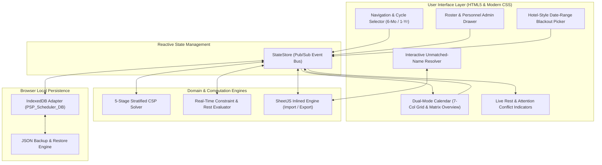

# Fire Marshal On-Call Schedule Generator & Editor

* **Author:** POLCHA
* **Status:** Draft
* **Date:** 2026-11-05

---

## Overview

The Fire Marshal On-Call Schedule Generator & Editor is a standalone, client-side offline web application designed to generate, manage, adjust, and distribute semi-annual (6-month) or annual duty schedules for Pennsylvania State Police (PSP) Fire Marshals and Alternates. Operating entirely within a single portable file (`index.html`), the application embeds local data persistence (IndexedDB), an administrative roster and date-range blackout manager, a 5-stage Stratified Constraint Satisfaction Problem (CSP) solver, and bidirectional spreadsheet parsing and generation matching the operational PSP barracks format.

## The Problem

Scheduling on-call duty for fire investigation units involves strict operational, contractual, and fatigue-management rules governed by Pennsylvania State Police enlisted regulations:
1. **Severe Manpower Constraints & Rest Invariants:** In a typical barracks unit, only 3 or 4 Full-Time (FT) members and a small pool of Alternates (ALT) cover 24/7 on-call duty every day of the year. When an FT member works a weekend shift (Friday through Sunday or Monday), they are legally entitled to 4 consecutive Regular Days Off (RDO) the following week, blocking them from Wednesday through Friday shifts.
2. **Phase Transitions & Personnel Volatility:** Staffing levels shift mid-cycle due to transfers, retirements, or probationary rotations (e.g., dropping from 4 FT members in Phase 1 to 3 FT members in Phase 2). With only 3 FT members active, a single member taking leave creates an immediate mathematical bottleneck where the remaining 2 members must cover the week without violating post-weekend rest rules.
3. **Fragile Spreadsheet Workflows:** Barracks administrators currently construct and maintain schedules manually across complex spreadsheets. Manual assignment frequently leads to inadvertent rest rule violations, unbalanced weekend loads, or uncoordinated blackout clashes. Existing spreadsheet formulas cannot handle multi-variable constraint satisfaction, while enterprise cloud applications cannot be installed or accessed on restricted law-enforcement networks due to security, hosting, and network isolation policies.
4. **Interoperability Requirements:** Any software solution must run locally without installation permissions, maintain persistence across sessions, and exchange data directly with existing command spreadsheets without altering the traditional 7-column wall-calendar format posted in the barracks.

## Goals

* **G-1: 100% Offline Single-File Portability:** Package the entire application (HTML, CSS, JavaScript runtime, and spreadsheet parsing/generation engine) into a single standalone `index.html` file that opens directly in standard web browsers (`file:///`) on enterprise workstations without web servers, external network connections, or installation privileges.
* **G-2: Automated CSP Schedule Generation:** Provide an automated 5-stage Stratified Constraint Satisfaction Problem solver capable of generating conflict-free schedules across 6-month or 1-year blocks in under 50 milliseconds, enforcing daily coverage, FT weekday exclusivity, 4-day post-weekend rest, non-consecutive weekend constraints, and strict Alternate weekend quotas (3 per half / 6 per year).
* **G-3: Proactive Deadlock Avoidance & Bounded Rule Relaxation:** Proactively identify FT full-week vacations and assign an Alternate to the preceding weekend to preserve the rest eligibility of remaining FT members. Restrict automated rule relaxation strictly to reallocating and combining weekday shifts among active FT members, accompanied by visual attention badges for multi-shift coverage.
* **G-4: Administrative Roster & Date-Range Intake:** Deliver an administrative interface allowing dynamic management of FT and ALT personnel, tenure dates (start, transfer, retirement), baseline weekday preferences, and a visual hotel-style calendar range picker for booking vacations and blackouts.
* **G-5: Immutable Historical Cycle Locking:** Preserve roster configurations independently per scheduling cycle so that personnel changes, retirements, or transfers in subsequent cycles do not mutate historical schedules or archived records.
* **G-6: Embedded Persistence & Backup:** Store all rosters, blackouts, holidays, schedule revisions, and named snapshots locally using browser-native IndexedDB, with complete JSON export and restore capabilities.
* **G-7: Bidirectional Spreadsheet Interoperability:** Ingest operational schedules from Excel or Google Sheets in either the traditional 7-column barracks grid layout or a standard 2-column tabular list (`Date`, `Member`), featuring an interactive reconciliation modal for unmatched employee names. Export pixel-faithful `.xlsx` workbooks mirroring the operational barracks calendar grid.
* **G-8: Barracks Print Layout:** Include dedicated print styling (`@media print`) that produces clean landscape monthly duty sheets formatted for physical bulletin board posting without browser UI elements.

## Non-Goals

* **NG-1: Cloud Hosting & Multi-User Collaboration:** The tool will not provide server-side infrastructure, remote user authentication, or real-time concurrent multi-user synchronization.
* **NG-2: Direct Cloud API Synchronization:** The tool will not connect directly to Google Drive, Google Sheets API, or Microsoft Graph API; spreadsheet exchanges are conducted strictly via locally downloaded `.xlsx` and `.csv` files.
* **NG-3: Payroll & Financial Overtime Calculations:** The tool will not calculate hourly wages, overtime pay, shift differentials, or timesheet financial ledgers.
* **NG-4: Union Rule Dilution:** The solver will never compress post-weekend rest windows, assign Alternates to mid-week shifts (except attached Monday holidays), or exceed Alternate weekend quotas to resolve deadlocks. Unresolvable scheduling deadlocks will halt and prompt the administrator for intervention.

## Open Questions

* **OQ-1**: For public holidays that fall on a mid-week day (e.g., General Election Day on Tuesday, Veterans Day on Thursday, Thanksgiving on Thursday), are these shifts covered as standard weekday on-call duties by the assigned FT member, or do they require special assignment weighting?
* **OQ-2**: In the event of a long-term emergency absence (e.g., multiple FT members unavailable simultaneously), should the manual override mode allow an administrator to force an Alternate into a weekday shift with an explicit printed "Administrative Exemption" footnote?

## Critical User Journeys (CUJs)

### CUJ 1: Initial Roster & Cycle Setup
* **Given**: An administrator opens `index.html` on a clean browser session with no pre-existing data.
* **When**: The administrator navigates to Roster Settings, inputs active FT members (POLCHA, TEREK, WOLFE), adds a temporary FT member (KEMERER with an active window ending Feb 28, 2027), defines Alternates (CHESTER, ZEIDERS, REED), and selects the 2027 H1 scheduling horizon (Jan 1 – Jun 30, 2027).
* **Then**: The application initializes the cycle record in IndexedDB, establishes baseline weekday affinities, and renders an empty 6-month operational calendar matrix ready for blackout input.

### CUJ 2: Booking Vacation Blackouts & Solving H1 2027
* **Given**: Roster and holiday dates are initialized for 2027 H1.
* **When**: The administrator uses the date-range picker to enter Polcha's time off (Jan 16–17, Jan 30–31, Feb 11–15, Feb 27–28), Wolfe's vacation (Feb 22–26, May 10–14), and Terek's leave (Mar 26–27, May 28, Jun 26–Jul 3), then clicks "Auto-Generate Schedule".
* **Then**: The 5-stage CSP solver executes in under 50ms, places Alternates on lookahead weekends prior to Wolfe's and Terek's leaves, respects Alternate weekend quotas (3 per ALT), fills all weekday and weekend shifts without violating post-weekend rest, and renders the completed calendar with zero unassigned slots.

### CUJ 3: Importing Historical Barracks Spreadsheet with Name Reconciliation
* **Given**: An administrator possesses a historical barracks schedule (`calendar_2027_reference.csv` or `.xlsx`) containing retired members (`KEEBAUGH`) or unfamiliar formatting.
* **When**: The administrator drags the spreadsheet into the Import drawer.
* **Then**: The importer parses the 7-column monthly blocks, extracts daily assignments, identifies `KEEBAUGH` as an unrecognized name against the active 2027 roster, displays the interactive Unmatched-Name Resolution modal, allows the administrator to map the name to a historical inactive record, and populates the calendar with full fidelity.

### CUJ 4: Manual Override with Real-Time Conflict Detection
* **Given**: A generated schedule is active in the calendar view.
* **When**: The administrator clicks a Wednesday shift and manually reassigns it to an FT member who worked the preceding weekend.
* **Then**: The application updates the assignment, immediately overlays a warning badge indicating a violation of the 4-day Post-Weekend Compensatory Rest Rule, and highlights the shift in amber without crashing or corrupting the schedule state.

### CUJ 5: Exporting Formatted Barracks Excel Workbook
* **Given**: A finalized 6-month or 1-year duty schedule.
* **When**: The administrator clicks "Export to Excel".
* **Then**: The application utilizes inlined SheetJS to compile and trigger a download of an `.xlsx` file formatted identically to the operational barracks standard, featuring 7-column monthly blocks, date headers, centered personnel names, and merged operational footnote notes.

---

## Technical Plan (Architecture)

### 1. High-Level Component & Data Flow Architecture

The application is structured into seven modular layers compiled into a single `index.html` file. The design uses standard ES6+ modules with a decoupled reactive event bus (`StateStore`), avoiding heavy frameworks or build-chain requirements.



### 2. Embedded Database Schema (`PSP_Scheduler_DB`, IndexedDB Version 1)

All records are indexed locally within IndexedDB under the database name `PSP_Scheduler_DB`. The database defines five distinct object stores:

```typescript
// Object Store: 'roster' (KeyPath: 'id')
interface RosterMember {
  id: string;               // UUID or normalized slug (e.g. 'polcha')
  name: string;             // Display name (e.g. 'POLCHA')
  role: 'FT' | 'ALT';       // Full-Time vs Alternate
  activeStart: string;      // ISO Date 'YYYY-MM-DD'
  activeEnd: string | null; // ISO Date 'YYYY-MM-DD' or null for indefinite
  baselineWeekday: number;  // 1 = Mon, 2 = Tue, 3 = Wed, 4 = Thu
  color: string;            // Hex color code for UI badges
}

// Object Store: 'blackouts' (KeyPath: 'id')
interface MemberBlackout {
  id: string;
  memberId: string;
  startDate: string;        // 'YYYY-MM-DD'
  endDate: string;          // 'YYYY-MM-DD'
  type: 'blackout' | 'preferred_weekend';
  notes?: string;
}

// Object Store: 'holidays' (KeyPath: 'date')
interface EnlistedHoliday {
  date: string;             // 'YYYY-MM-DD'
  year: number;
  name: string;
  type: 'attached_fri' | 'attached_mon' | 'midweek' | 'weekend';
  premium: boolean;
}

// Object Store: 'schedules' (KeyPath: 'id')
interface ScheduleCycle {
  id: string;               // e.g. '2027-H1', '2027-FULL'
  year: number;
  blockType: 'H1' | 'H2' | 'FULL';
  startDate: string;
  endDate: string;
  rosterSnapshot: RosterMember[];  // Immutable historical roster for this cycle
  assignments: Record<string, string>; // Date -> memberId
  manualOverrides: Record<string, boolean>; // Date -> true if manually set
  updatedAt: number;
}

// Object Store: 'snapshots' (KeyPath: 'id')
interface ScheduleSnapshot {
  id: string;
  scheduleId: string;
  label: string;
  timestamp: number;
  payload: ScheduleCycle;
}
```

### 3. The 5-Stage Stratified CSP Solver Algorithm

Standard global backtracking across 180 to 365 daily variables results in combinatorial deadlocks due to the non-linear 4-day compensatory rest rule. The scheduling engine decomposes the problem into 5 stratified phases that mimic command decision-making:

```
┌────────────────────────────────────────────────────────────────────────┐
│ STAGE 1: Lock Manuals & Proactive Leave Lookaheads                     │
│ 1. Fix user-defined manual overrides and administrative locks.         │
│ 2. Detect any FT member with full-week leave (Mon–Fri).                │
│    -> Force an eligible Alternate to Weekend W-1 (Preceding Weekend).  │
│    -> Result: Both remaining FT members enter the week fully rested.   │
└───────────────────────────────────┬────────────────────────────────────┘
                                    ▼
┌────────────────────────────────────────────────────────────────────────┐
│ STAGE 2: Alternate Weekend Quota Allocation (CSP)                      │
│ 1. Filter weekends eligible for Alternates (no blackouts).             │
│ 2. Assign exactly 3 weekends per Alternate in H1 and 3 in H2 (MRV).    │
│ 3. Enforce hard constraint: No consecutive weekends for any Alternate. │
│ 4. Attach Monday holidays to Alternate if applicable (Memorial/Labor). │
└───────────────────────────────────┬────────────────────────────────────┘
                                    ▼
┌────────────────────────────────────────────────────────────────────────┐
│ STAGE 3: Full-Time Weekend Allocation                                  │
│ 1. Assign remaining 17 weekends per half-year across active FT members.│
│ 2. Enforce Phase 1 vs. Phase 2 eligibility (Kemerer active Jan–Feb).   │
│ 3. Enforce member blackout restrictions and non-consecutive rule.      │
│ 4. Balance weekend counts (~11–12 per active full-year FT member).     │
└───────────────────────────────────┬────────────────────────────────────┘
                                    ▼
┌────────────────────────────────────────────────────────────────────────┐
│ STAGE 4: Attached Holiday & Monday Shift Settlement                    │
│ 1. Phase 1 Attached Mondays: Assigned to weekend worker.               │
│ 2. Phase 2 Attached Mondays: Assigned to weekend worker (FT or ALT).   │
│ 3. Phase 2 Non-Holiday Mondays on ALT Weekends: Distribute among       │
│    rested FT members via round-robin.                                  │
└───────────────────────────────────┬────────────────────────────────────┘
                                    ▼
┌────────────────────────────────────────────────────────────────────────┐
│ STAGE 5: Mid-Week (Mon–Thu) Allocation & Bounded Swapping              │
│ 1. Seed Tuesday–Thursday with baseline preferences:                    │
│    Tue=Kemerer/Terek, Wed=Wolfe, Thu=Terek, Mon=Polcha.                │
│ 2. Evaluate 4-day Post-Weekend Rest: If FT worked Weekend W, ban       │
│    on Wednesday, Thursday, and Friday of Week W+1.                     │
│ 3. If assigned member is in rest or blackout:                          │
│    a. Reassign shift to an available active FT member.                 │
│    b. Permitted: Same FT member may take multiple mid-week shifts      │
│       during the week (flagged with UI attention badge).               │
│ 4. If zero FT members are legally available:                           │
│    Halt and mark the slot as UNASSIGNED with Diagnostic Conflict Flag. │
└────────────────────────────────────────────────────────────────────────┘
```

### 4. Excel & Spreadsheet Engine (Inlined SheetJS Architecture)

To run 100% offline without external CDN calls, the minified SheetJS library (`xlsx.full.min.js`, ~1.1MB) is inlined directly in `<script>` tags within `index.html`.

#### A. Export Pipeline
1. Builds a multi-sheet or single-workbook `.xlsx` container.
2. Formats each month into a 7-column block matching the operational format:
   - Row 1: Month & Year header (e.g. `2027, January`)
   - Row 2: Days of week (`MONDAY, TUESDAY, WEDNESDAY, THURSDAY, FRIDAY, SATURDAY, SUNDAY`)
   - Row 3: ISO Date string row (`2027-01-04, 2027-01-05...`)
   - Row 4: Member assignment names (`POLCHA, POLCHA, WOLFE...`)
   - Row 5: Repeating date/assignment blocks for subsequent weeks.
   - Final Row: Merged operational footnote (`Notes: On call starts PM that day after scheduled shift into next morning 0600hrs`).
3. Uses SheetJS cell styling objects for bold headers, light-gray borders, and centered text.

#### B. Dual-Format Import Pipeline
The importer parses any dropped `.xlsx` or `.csv` file via a 2-pass heuristic:
* **Format 1 (Barracks 7-Column Grid):** Scans rows for the presence of the `MONDAY,TUESDAY` header signature. Pairs each subsequent date row with the corresponding personnel name row, extracting daily assignments while ignoring notes rows.
* **Format 2 (Tabular 2-Column Roster):** Scans for column headers containing `Date` and `Name`/`Member`. Parses row-by-row ISO dates and assigned strings.
* **Unmatched-Name Resolution Modal:** If parsed names do not match active roster entries (e.g., `KEEBAUGH`, `RILEY`, or spelling variants), the importer opens an interactive reconciliation modal allowing the administrator to:
  1. Map to an existing active member (with Levenshtein-distance suggestions).
  2. Map to a historical/inactive member.
  3. Leave the shift blank for manual assignment.

### 5. Conflict & Attention Detection Subsystem

The application runs a lightweight constraint evaluation pass whenever the calendar state changes:
1. **Rest Violation (Red Indicator):** Triggered when an FT member who worked Weekend $W$ is assigned to Wed, Thu, or Fri of Week $W+1$. Displays tooltip: *"Post-Weekend Rest Violation: Member completed 4-day weekend on [Date]."*
2. **Blackout Clashes (Red Indicator):** Triggered when a member is assigned on a date falling within their approved leave window.
3. **Multi-Shift Weekday Coverage (Amber Attention Badge):** Triggered when an FT member covers two or more mid-week shifts in the same calendar week. Highlights the shift to bring it to the administrator's attention while remaining valid.
4. **Consecutive Weekend Warning (Orange Indicator):** Triggered if any member is manually placed on back-to-back weekends.

### 6. Barracks Print Styling Pipeline (`@media print`)

A specialized CSS print stylesheet hides all UI headers, navigation buttons, drawers, and modal backdrops during browser printing (`Ctrl+P`):
- Sets `@page { size: landscape; margin: 0.5in; }`
- Forces CSS Grid to render one full month block per physical page with page-break-after rules (`page-break-after: always`).
- Renders crisp high-contrast black-and-white borders with bold uppercase names, exactly reproducing the traditional physical station board posting.

---

## Alternatives Considered

### Alternative A: Multi-Tier Automated Rule Relaxation (Compressing Rest, Alternate Mid-Weeks)

* **Pros**: Eliminates unassigned slots automatically during extreme staffing shortages without requiring administrative attention.
* **Cons**: Violates Pennsylvania State Police enlisted labor agreements and mandatory fatigue management policies. Assigning Alternates to mid-week shifts breaches job classification boundaries.
* **Reason for Rejection**: *Rejected by author:* Union and operational safety rules strictly prohibit compressing 4-day post-weekend rest or assigning Alternates to regular mid-week shifts. Permitting active FT members to cover multiple mid-week shifts (with visible amber attention badges) resolves tight weeks cleanly within contractual boundaries. Any scenario that exceeds this must be surfaced to the administrator for explicit manual intervention rather than resolved automatically.

### Alternative B: Packaged Desktop Application (Electron / Tauri)

* **Pros**: Provides native OS window chrome, automated file-system read/write without browser download prompts, and desktop launcher shortcuts.
* **Cons**: Requires installer execution, administrator privileges, and ongoing security review on state enterprise workstations. Large bundle size (80–120 MB for Electron) and complex cross-compilation pipeline.
* **Reason for Rejection**: *Rejected by author:* Enterprise IT restrictions on state police workstations block unapproved desktop installers and `.exe` binaries. A single, self-contained `index.html` file (~1.5 MB) runs natively within existing enterprise Chromium/Edge browsers without installation permissions, providing maximum field portability across USB drives and local disks.

### Alternative C: Global Backtracking / Integer Linear Programming (ILP) Solver

* **Pros**: Formally guarantees global mathematical optimality across multi-objective utility functions.
* **Cons**: Requires heavy WebAssembly dependencies (e.g. GLPK or Z3-WASM, ~5–10 MB), exhibits unpredictable exponential runtimes on contradictory constraint sets, and functions as an opaque black box that cannot explain *why* a schedule failed.
* **Reason for Rejection**: *Rejected by author:* Heavy WASM solvers introduce bloat and opacity. The 5-stage stratified solver executes deterministically in under 50ms, exactly mimics natural barracks scheduling logic, and provides human-readable diagnostic explanations for any unassigned shift.

### Alternative D: Live Cloud API Synchronization (Google Sheets / Microsoft 365)

* **Pros**: Enables real-time synchronization with cloud spreadsheets and automated team distribution via Google Drive.
* **Cons**: Requires constant internet access, OAuth client credential management, cloud API tokens, and exposure of internal duty rosters to third-party endpoints.
* **Reason for Rejection**: *Rejected by author:* Violates the mandatory 100% offline requirement. Workstations in remote barracks or secure environments frequently operate in air-gapped or restricted-intranet modes. Ingesting and exporting local `.xlsx`/`.csv` files preserves operational security and full offline independence.

### Alternative E: Server-Hosted Database (PostgreSQL / MySQL)

* **Pros**: Centralized storage accessible by multiple remote workstations concurrently.
* **Cons**: Requires hosting infrastructure, database maintenance, network firewall configuration, database backup scripts, and authentication management.
* **Reason for Rejection**: *Rejected by author:* Server infrastructure introduces deployment friction, hosting overhead, and networking prerequisites. Browser-native IndexedDB provides persistent, zero-maintenance local storage with full JSON export/restore capabilities directly on the administrator's computer.

---

## Non-Functional Requirements

### Security & Privacy
* **Air-Gapped Operation:** Zero outbound network calls. All application logic, assets, and dependencies execute entirely within the local browser sandbox.
* **Data Sovereignty:** All personnel rosters, contact designations, leave dates, and schedule assignments remain strictly within local browser storage (IndexedDB) or local files. No analytics, tracking pixels, or third-party telemetry.

### Performance & Latency
* **Solver Execution:** 5-stage CSP solver execution completes in under 50 milliseconds for a full 6-month or 1-year block.
* **Interactive UI Responsiveness:** Instantaneous DOM updates (< 16ms, 60fps) during calendar navigation, manual cell overrides, and drawer toggling.
* **Bundle Footprint:** Total bundled file size not to exceed 2.0 MB (inclusive of inlined SheetJS engine, SVG icons, and CSS styles).

### Reliability & Data Integrity
* **Atomic Versioning:** Every manual override or schedule regeneration writes an immutable snapshot to IndexedDB, supporting infinite undo/redo and point-in-time rollback.
* **Cycle Isolation:** Roster snapshots are frozen per scheduling cycle to prevent cascade corruption of historical schedules when editing future cycles.

---

## Detailed Implementation Plan

### Target Files to Create/Modify

#### 1. `index.html` (Create)
* **Type / Scope**: Self-contained single-file HTML5 web application.
* **Proposed Changes**: Implement the master application containing:
  - Inlined CSS architecture (CSS custom properties, typography, responsive grid, drawer transitions, color-coded badges, and `@media print` rules for barracks landscape printouts).
  - Inlined minified SheetJS library (`xlsx.full.min.js`) for client-side workbook generation and binary file parsing.
  - Reactive `StateStore` module managing cycles, active view modes, rosters, blackouts, and undo/redo history.
  - `StorageAdapter` wrapping browser IndexedDB (`PSP_Scheduler_DB`) with promise-based CRUD operations, automatic schema initialization, and JSON snapshot backup/restore.
  - `RosterManager` UI drawer supporting addition/removal of members, FT/ALT toggle, active date bounds, and weekday preference assignments.
  - `BlackoutManager` UI drawer featuring the hotel-style date-range calendar picker for multi-day vacation booking and reason tags.
  - `CSPSolver` implementing the 5-stage Stratified Constraint Satisfaction algorithm with proactive lookaheads and FT weekday swapping.
  - `ConflictEngine` evaluating real-time rest violations, blackout clashes, and multi-shift FT attention badges.
  - `ExcelEngine` implementing dual-format parsing (7-column grid and 2-column tabular list) and pixel-accurate 7-column barracks `.xlsx` export.
  - `UnmatchedNameResolver` modal providing an interactive reconciliation workflow with alias mapping and fuzzy suggestions.
  - Interactive calendar renderer supporting monthly 7-column grid view, 6-month overview matrix, and click-to-reassign popovers.

#### 2. `tests/solver_test.html` (Create)
* **Type / Scope**: Standalone offline browser-based test suite.
* **Proposed Changes**: Implement an automated test runner with zero external dependencies to verify:
  - Stage 1: Validation of proactive lookahead alternate assignment prior to FT vacation weeks (e.g. Wolfe May 10–14 and Terek Jun 26–Jul 3).
  - Stage 2: Verification of Alternate weekend quotas (exactly 3 per ALT in H1, exactly 3 in H2).
  - Stage 3: Enforcement of the 4-day Post-Weekend Compensatory Rest Rule (Wed–Fri blackout following FT weekend duty).
  - Stage 4: Strict prohibition of consecutive weekends across all personnel.
  - Stage 5: Bounded rule relaxation testing (verifying that only FT weekday reallocations occur and multi-shift assignments trigger attention badges).
  - Parity regression: Validate generated assignments against `calendar_2027_reference.csv` for 2027 H1.

#### 3. `docs/USER_GUIDE.md` (Create)
* **Type / Scope**: Operational administrator manual.
* **Proposed Changes**: Provide step-by-step instructions for barracks administrators:
  - Opening the application from disk or USB.
  - Creating a new 6-month or 1-year scheduling cycle.
  - Managing roster personnel, tenure limits, and historical cycle locking.
  - Booking multi-day vacation ranges using the visual date-range picker.
  - Running the auto-scheduler and interpreting conflict/attention badges.
  - Performing manual overrides and resolving unassigned shift deadlocks.
  - Ingesting external spreadsheets and resolving unrecognized employee names.
  - Exporting official `.xlsx` workbooks and printing physical barracks wall calendars.

#### 4. `calendar_2027_reference.csv` (Preserve / Reference)
* **Type / Scope**: Historical reference data.
* **Proposed Changes**: Retain existing operational 2027 calendar CSV as the authoritative test fixture and import benchmark.

#### 5. `scheduling_spec_2027.md` (Preserve / Reference)
* **Type / Scope**: Domain rules specification.
* **Proposed Changes**: Retain as the formal baseline documentation of Pennsylvania State Police enlisted on-call rules.

### Verification Plan

* **Offline Execution & Bundle Verification**:
  - Open `index.html` directly from the filesystem (`file:///c:/Users/polch/Work_Calendar/index.html`) in Google Chrome and Microsoft Edge with network disabled (air-gapped mode).
  - Confirm zero console errors, zero failed network requests, and total bundle footprint under 2.0 MB.
* **Algorithmic Correctness & Regression Suite**:
  - Open `tests/solver_test.html` in browser.
  - Verify that 100% of automated unit tests pass:
    - 2027 H1 schedule generation completes with 100% coverage (zero unassigned days).
    - Exactly 9 Alternate weekends in H1 (3 for Chester, 3 for Zeiders, 3 for Reed).
    - Zero consecutive weekends for any member.
    - Zero post-weekend rest violations across all 181 days.
    - Wolfe May 10–14 vacation preceded by Alternate weekend (May 7–9).
    - Terek Jun 26–Jul 3 vacation preceded by Alternate weekend (Jun 25–27).
* **Spreadsheet Round-Trip Verification**:
  - Import `calendar_2027_reference.csv` into the application via drag-and-drop.
  - Verify that the Unmatched-Name Resolution modal detects `KEEBAUGH` and allows alias mapping.
  - Verify that all imported daily assignments populate the calendar grid accurately.
  - Click "Export to Excel", open the resulting `.xlsx` in Microsoft Excel, and verify formatting: 7-column layout, date headers, centered uppercase names, and merged operational footnote notes.
* **Conflict & Attention Badge Verification**:
  - Perform a manual override placing an FT member on Wednesday following their weekend shift; verify immediate red warning badge.
  - Force an FT member into two mid-week shifts; verify amber attention badge is displayed.
* **Print Styling Verification**:
  - Open Print Preview (`Ctrl+P`) on the calendar view.
  - Verify that UI buttons, drawers, and headers are hidden, and each monthly calendar sheet fits cleanly onto a single landscape page.

---

## Additional Resources

* Pennsylvania State Police Enlisted Leave Tracker (Holiday calendar specifications and attached holiday rules).
* `calendar_2027_reference.csv`: Baseline operational 2027 barracks schedule for regression verification and import testing.
* `scheduling_spec_2027.md`: PSP Fire Marshal 2027 Scheduling Specification.

---

## Future Improvements

* **Automated Shift Trade Protocol**: Future support for generating two-party shift trade endorsement slips for administrative signature.
* **Multi-Station Federation**: Future capability to export and import standardized station roster templates across adjacent barracks troops.

---

*Drafted with EGM*
