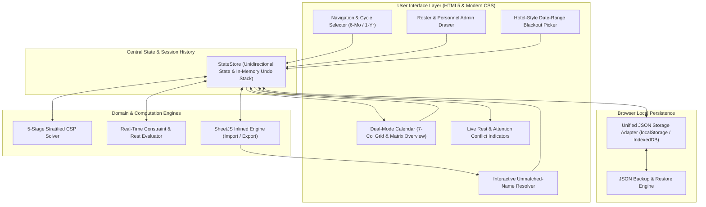

# Fire Marshal On-Call Schedule Generator & Editor

* **Author:** POLCHA
* **Status:** Approved
* **Date:** 2026-11-05

---

## Overview

The Fire Marshal On-Call Schedule Generator & Editor is a standalone, client-side offline web application designed to generate, manage, adjust, and distribute semi-annual (6-month) or annual duty schedules for Pennsylvania State Police (PSP) Fire Marshals and Alternates. Operating entirely within a single portable file (`index.html`), the application embeds local data persistence, an administrative roster and date-range blackout manager, a 5-stage Stratified Constraint Satisfaction Problem (CSP) solver, and bidirectional spreadsheet parsing and generation matching the operational PSP barracks format.

## The Problem

Scheduling on-call duty for fire investigation units involves strict operational, contractual, and fatigue-management rules governed by Pennsylvania State Police enlisted regulations:
1. **Severe Manpower Constraints & Rest Invariants:** In a typical barracks unit, only 3 or 4 Full-Time (FT) members and a small pool of Alternates (ALT) cover 24/7 on-call duty every day of the year. When an FT member works a weekend shift (Friday through Sunday in Phase 1, or Friday through Monday in Phase 2), their departmental schedule entitles them to 4 consecutive Regular Days Off (RDO) the following week (Thursday through Sunday). Under on-call fatigue rules, they are strictly prohibited from on-call duty on Wednesday (the day preceding RDO), Thursday, and Friday.
2. **Phase Transitions & Personnel Volatility:** Staffing levels shift mid-cycle due to transfers, retirements, or probationary rotations (e.g., dropping from 4 FT members in Phase 1 to 3 FT members in Phase 2). With only 3 FT members active, whenever one member takes approved leave, only 2 FT members remain. If one of those 2 worked the preceding weekend, the post-weekend rest rule leaves only 1 member to cover mid-week shifts, triggering a mathematical deadlock unless managed proactively.
3. **Fragile Spreadsheet Workflows:** Barracks administrators currently construct and maintain schedules manually across complex spreadsheets. Manual assignment frequently leads to inadvertent rest rule violations, unbalanced weekend loads, or uncoordinated blackout clashes. Existing spreadsheet formulas cannot handle multi-variable constraint satisfaction, while enterprise cloud applications cannot be installed or accessed on restricted law-enforcement networks due to security, hosting, and network isolation policies.
4. **Interoperability Requirements:** Any software solution must run locally without installation permissions, maintain persistence across sessions, and exchange data directly with existing command spreadsheets without altering the traditional 7-column wall-calendar format posted in the barracks.

## Goals

* **G-1: 100% Offline Single-File Portability:** Package the entire application (HTML, CSS, JavaScript runtime, and spreadsheet parsing/generation engine) into a single standalone `index.html` file that opens directly in standard web browsers (`file:///`) on enterprise workstations without web servers, external network connections, or installation privileges.
* **G-2: Automated CSP Schedule Generation:** Provide an automated 5-stage Stratified Constraint Satisfaction Problem solver capable of generating conflict-free schedules across 6-month or 1-year blocks in under 50 milliseconds, enforcing daily coverage, FT weekday exclusivity, 4-day post-weekend rest, non-consecutive weekend constraints, and strict Alternate weekend quotas (3 per half / 6 per year).
* **G-3: Proactive Deadlock Avoidance & Bounded Rule Relaxation:** Proactively identify multi-day FT leaves in Phase 2 and assign an Alternate to the preceding weekend to preserve the rest eligibility of remaining FT members. Restrict automated rule relaxation strictly to reallocating and combining weekday shifts among active FT members, accompanied by visual attention badges for multi-shift coverage.
* **G-4: Administrative Roster & Date-Range Intake:** Deliver an administrative interface allowing dynamic management of FT and ALT personnel, tenure dates (start, transfer, retirement), baseline weekday preferences, and a visual hotel-style calendar range picker for booking vacations and blackouts.
* **G-5: Immutable Historical Cycle Locking:** Preserve roster configurations and blackout entries independently per scheduling cycle so that personnel changes, retirements, or transfers in subsequent cycles do not mutate historical schedules or archived records.
* **G-6: Embedded Persistence & Backup:** Store all state locally using browser storage (`localStorage` or single-key IndexedDB), with synchronous memory execution, in-memory session undo/redo, and complete JSON export and restore capabilities.
* **G-7: Bidirectional Spreadsheet Interoperability:** Ingest operational schedules from Excel or Google Sheets in either the traditional 7-column barracks grid layout or a standard 2-column tabular list (`Date`, `Member`), featuring an interactive reconciliation modal for unmatched employee names. Export pixel-faithful `.xlsx` workbooks mirroring the operational barracks calendar grid.
* **G-8: Barracks Print Layout:** Include dedicated print styling (`@media print`) that produces clean landscape monthly duty sheets formatted for physical bulletin board posting without browser UI elements.

## Non-Goals

* **NG-1: Cloud Hosting & Multi-User Collaboration:** The tool will not provide server-side infrastructure, remote user authentication, or real-time concurrent multi-user synchronization.
* **NG-2: Direct Cloud API Synchronization:** The tool will not connect directly to Google Drive, Google Sheets API, or Microsoft Graph API; spreadsheet exchanges are conducted strictly via locally downloaded `.xlsx` and `.csv` files.
* **NG-3: Payroll & Financial Overtime Calculations:** The tool will not calculate hourly wages, overtime pay, shift differentials, or timesheet financial ledgers.
* **NG-4: Union Rule Dilution:** The solver will never compress post-weekend rest windows, assign Alternates to regular mid-week shifts, or exceed Alternate weekend quotas to resolve deadlocks. Unresolvable scheduling deadlocks will halt and prompt the administrator for intervention.

## Confirmed Policy Resolutions (Formerly Open Questions)

* **Mid-Week Public Holidays (Resolved):** Public holidays that fall on a mid-week day (General Election Day on Tuesday, Veterans Day on Thursday, Thanksgiving on Thursday) are standard weekday on-call duties covered by the assigned Full-Time member per the normal rotation, with no special solver weighting or alternate rules.
* **Administrative Exemption Overrides (Resolved):** In catastrophic emergency staffing shortages, the manual calendar override mode permits an administrator to force an Alternate into a weekday shift. When this occurs, the UI displays a prominent Red Conflict badge, and Excel export automatically appends an official footnote: *"Administrative Exemption: Manual Alternate Weekday Assignment"*.

## Critical User Journeys (CUJs)

### CUJ 1: Initial Roster & Cycle Setup
* **Given**: An administrator opens `index.html` on a clean browser session with no pre-existing data.
* **When**: The administrator navigates to Roster Settings, inputs active FT members (POLCHA, TEREK, WOLFE), adds a temporary FT member (KEMERER with an active window ending Feb 28, 2027), defines Alternates (CHESTER, ZEIDERS, REED), and selects the 2027 H1 scheduling horizon (Jan 1 – Jun 30, 2027).
* **Then**: The application initializes the cycle record in local persistence, establishes baseline weekday affinities, and renders an empty 6-month operational calendar matrix ready for blackout input.

### CUJ 2: Booking Vacation Blackouts & Solving H1 2027
* **Given**: Roster and holiday dates are initialized for 2027 H1.
* **When**: The administrator uses the date-range picker to enter Polcha's time off (Jan 16–17, Jan 30–31, Feb 11–15, Feb 27–28), Wolfe's vacation (Feb 22–26, May 10–14), and Terek's leave (Mar 26–27, May 28, Jun 26–Jul 3), then clicks "Auto-Generate Schedule".
* **Then**: The 5-stage CSP solver executes in under 50ms, places Alternates on lookahead weekends prior to Wolfe's and Terek's leaves, respects Alternate weekend quotas (3 per ALT), fills all weekday and weekend shifts without violating post-weekend rest, and renders the completed calendar with zero unassigned slots.

### CUJ 3: Importing Historical Barracks Spreadsheet with Name Reconciliation
* **Given**: An administrator possesses a historical barracks schedule (`calendar_2027_reference.csv` or `.xlsx`) containing retired members (`KEEBAUGH`), transfer personnel (`RILEY`), or unfamiliar formatting.
* **When**: The administrator drags the spreadsheet into the Import drawer.
* **Then**: The importer parses the 7-column monthly blocks, extracts daily assignments, identifies `KEEBAUGH` and `RILEY` as unrecognized names against the active 2027 roster, displays the interactive Unmatched-Name Resolution modal, allows the administrator to map the names via clean dropdown selectors to historical inactive records, and populates the calendar with full fidelity.

### CUJ 4: Manual Override with Real-Time Conflict Detection
* **Given**: A generated schedule is active in the calendar view.
* **When**: The administrator clicks a Wednesday shift and manually reassigns it to an FT member who worked the preceding weekend.
* **Then**: The application updates the assignment, immediately overlays a warning badge indicating a violation of the 4-day Post-Weekend Compensatory Rest Rule, and highlights the shift in red without crashing or corrupting the schedule state.

### CUJ 5: Exporting Formatted Barracks Excel Workbook
* **Given**: A finalized 6-month or 1-year duty schedule.
* **When**: The administrator clicks "Export to Excel".
* **Then**: The application utilizes inlined SheetJS to compile and trigger a download of an `.xlsx` file formatted identically to the operational barracks standard, featuring 7-column monthly blocks, date headers, centered personnel names, and merged operational footnote notes.

---

## Technical Plan (Architecture)

### 1. High-Level Component & Data Flow Architecture

The application is structured into seven modular layers contained within a single `index.html` file. The design uses standard ES6+ modules with a central unidirectional state store, avoiding heavy frameworks or build-chain requirements.



### 2. Unified Document Data Schema (`AppState`)

To eliminate asynchronous multi-table relational join overhead, all application data is modeled as a single cohesive root state object:

```typescript
interface AppState {
  version: number;                             // Schema version (e.g. 1)
  roster: RosterMember[];                       // Master personnel list
  blackouts: MemberBlackout[];                 // Global time-off entries
  holidays: EnlistedHoliday[];                  // PSP calendar holidays
  cycles: Record<string, ScheduleCycle>;       // '2027-H1', '2027-FULL'
  activeCycleId: string;                        // Currently viewed cycle
  savedSnapshots: Record<string, ScheduleSnapshot>; // User-created checkpoints
}

interface RosterMember {
  id: string;               // Normalized slug (e.g. 'polcha')
  name: string;             // Display name (e.g. 'POLCHA')
  role: 'FT' | 'ALT';       // Full-Time vs Alternate
  activeStart: string;      // ISO Date 'YYYY-MM-DD'
  activeEnd: string | null; // ISO Date 'YYYY-MM-DD' or null for indefinite
  baselineWeekday?: number | null; // 1=Mon, 2=Tue, 3=Wed, 4=Thu (null for ALT)
  color: string;            // Hex color code for UI badges
}

interface MemberBlackout {
  id: string;
  memberId: string;
  startDate: string;        // 'YYYY-MM-DD'
  endDate: string;          // 'YYYY-MM-DD'
  notes?: string;
}

interface EnlistedHoliday {
  date: string;             // 'YYYY-MM-DD'
  year: number;
  name: string;
  type: 'attached_fri' | 'attached_mon' | 'midweek' | 'weekend';
}

interface ScheduleCycle {
  id: string;               // e.g. '2027-H1', '2027-FULL'
  year: number;
  blockType: 'H1' | 'H2' | 'FULL';
  startDate: string;
  endDate: string;
  rosterSnapshot: RosterMember[];       // Immutable historical roster for this cycle
  blackoutsSnapshot: MemberBlackout[];  // Immutable historical blackouts for this cycle
  assignments: Record<string, string>;  // Date -> memberId
  manualOverrides: Record<string, boolean>; // Date -> true if manually set
  solverDiagnostics?: Record<string, string>; // Date -> conflict diagnostic note
  updatedAt: number;
}

interface ScheduleSnapshot {
  id: string;
  scheduleId: string;
  label: string;
  timestamp: number;
  payload: ScheduleCycle;
}
```

### 3. The 5-Stage Stratified CSP Solver Algorithm

Standard global backtracking across 180 to 365 daily variables results in combinatorial deadlocks due to non-linear rest constraints. The scheduling engine decomposes the problem into 5 stratified phases:

```
┌────────────────────────────────────────────────────────────────────────┐
│ STAGE 1: Lock Manuals & Phase 2 Proactive Leave Lookaheads             │
│ 1. Lock user-defined manual overrides and administrative shifts.       │
│ 2. When active FT < 4 (Phase 2): Detect any FT member with leave       │
│    spanning >= 3 consecutive mid-week days (Mon–Thu) or full week.     │
│    -> Assign an eligible Alternate to Weekend W-1 (Preceding Weekend). │
│    -> Immediately deduct 1 weekend from that Alternate's Stage 2 quota!│
│    -> Result: Both remaining FT members enter the week fully rested.   │
└───────────────────────────────────┬────────────────────────────────────┘
                                    ▼
┌────────────────────────────────────────────────────────────────────────┐
│ STAGE 2: Alternate Weekend Quota Allocation (CSP via MRV)              │
│ 1. Calculate remaining quota for each Alternate (3 minus Stage 1 count)│
│ 2. Assign eligible weekends using Minimum Remaining Values (MRV -      │
│    prioritizing Alternates with the fewest available weekends first).  │
│ 3. Enforce hard constraint: No consecutive weekends for any Alternate. │
│ 4. Bind attached holidays to Alternate (Memorial, Labor, Columbus Day).│
└───────────────────────────────────┬────────────────────────────────────┘
                                    ▼
┌────────────────────────────────────────────────────────────────────────┐
│ STAGE 3: Full-Time Weekend Allocation                                  │
│ 1. Assign remaining weekends per half-year across active FT members.   │
│ 2. Enforce Phase 1 vs. Phase 2 eligibility (Kemerer active Jan–Feb).   │
│ 3. Enforce member blackout restrictions and non-consecutive rule.      │
│ 4. Enforce Friday Rest: FT member who worked Weekend W cannot start    │
│    Weekend W+1 on Friday.                                              │
│ 5. Balance weekend counts (~5–6 per FT in H1/H2; ~11–12 annually).     │
└───────────────────────────────────┬────────────────────────────────────┘
                                    ▼
┌────────────────────────────────────────────────────────────────────────┐
│ STAGE 4: Attached Holiday (Fri/Mon) & Monday Shift Settlement          │
│ 1. Attached Friday Holidays (New Year's Day, Good Friday): Bound to   │
│    the assigned weekend worker (FT or ALT).                            │
│ 2. Attached Monday Holidays (MLK, Presidents', Memorial, Labor,        │
│    Columbus Day): Bound to the assigned weekend worker (FT or ALT).    │
│ 3. Phase 2 Standard Mondays (FT Weekend): Covered by FT weekend worker│
│    (4-day shift: Fri–Mon).                                             │
│ 4. Phase 2 Standard Mondays (ALT Weekend): Settle Monday shift by      │
│    round-robin selection among available, rested FT members.           │
└───────────────────────────────────┬────────────────────────────────────┘
                                    ▼
┌────────────────────────────────────────────────────────────────────────┐
│ STAGE 5: Mid-Week Allocation (Phase 1 Baseline vs. Phase 2 Equity)     │
│ 1. Operate strictly on unassigned mid-week slots (Tue–Thu in Phase 2;  │
│    Tue–Thu plus unassigned Mon in Phase 1).                            │
│ 2. Post-Weekend Rest Enforcement: If FT worked Weekend W, ban on       │
│    Wednesday and Thursday of Week W+1.                                 │
│ 3. Phase 1 (4 FT members): Seed with baseline preferences              │
│    (Mon=Polcha, Tue=Kemerer, Wed=Wolfe, Thu=Terek); swap if conflict.  │
│ 4. Phase 2 (3 FT members): Distribute shifts using dynamic equity pool │
│    across rested FT members (Polcha, Terek, Wolfe).                    │
│ 5. Permitted Bounded Relaxation: Same FT member may take multiple      │
│    mid-week shifts during tight weeks (flagged with UI attention badge)│
│ 6. If zero FT members are legally available:                           │
│    Halt and mark the slot as UNASSIGNED with Diagnostic Conflict Flag. │
└────────────────────────────────────────────────────────────────────────┘
```

### 4. Excel & Spreadsheet Engine (Inlined SheetJS Architecture)

To run 100% offline without external CDN calls, the minified SheetJS library (`xlsx.full.min.js`, ~1.1MB) is inlined directly within `index.html`.

#### A. Export Pipeline
1. Builds a multi-sheet or single-workbook `.xlsx` container.
2. Formats each month into a 7-column block matching the operational format:
   - Row 1: Month & Year header (e.g. `2027, January`)
   - Row 2: Days of week (`MONDAY, TUESDAY, WEDNESDAY, THURSDAY, FRIDAY, SATURDAY, SUNDAY`)
   - Row 3: ISO Date string row (`2027-01-04, 2027-01-05...`)
   - Row 4: Member assignment names (`POLCHA, POLCHA, WOLFE...`)
   - Row 5: Repeating date/assignment blocks for subsequent weeks.
   - Final Row: Merged operational footnote (`Notes: On call starts PM that day after scheduled shift into next morning 0600hrs`).
   - If an administrative weekday exception exists, appends: `Notes: Administrative Exemption: Manual Alternate Weekday Assignment`.
3. Uses SheetJS cell styling for bold headers, light-gray borders, and centered text.

#### B. Dual-Format Import Pipeline
The importer parses any dropped `.xlsx` or `.csv` file via a 2-pass heuristic:
* **Format 1 (Barracks 7-Column Grid):** Reads with `{ cellDates: true }`. Scans rows for the `MONDAY` token signature and dynamically aligns columns relative to that token (tolerating empty leading columns like column A in `calendar_2027_reference.csv`). Pairs date rows with assignment rows, ignoring notes.
* **Format 2 (Tabular 2-Column Roster):** Scans for column headers containing `Date` and `Name`/`Member`. Parses row-by-row ISO dates and assigned strings.
* **Unmatched-Name Resolution Modal:** If parsed names do not match active roster entries (e.g., `KEEBAUGH`, `RILEY`), the importer displays a reconciliation modal with a clean `<select>` dropdown allowing the administrator to:
  1. Map to an existing active member.
  2. Map to a historical/inactive member.
  3. Leave the shift blank for manual assignment.

### 5. Conflict & Attention Detection Subsystem (`ConflictEngine`)

The application evaluates constraints whenever the calendar state changes:
1. **Rest Violation (🔴 Red Indicator):** Triggered when an FT member who worked Weekend $W$ is assigned to Wed, Thu, or Fri of Week $W+1$. Tooltip: *"Post-Weekend Rest Violation: Member on 4-day RDO following weekend duty."*
2. **Blackout Clashes (🔴 Red Indicator):** Triggered when a member is assigned on a date falling within their approved leave window.
3. **Alternate Weekday Assignment (🔴 Red Indicator):** Triggered when an Alternate is placed on Monday–Thursday outside attached Monday holidays.
4. **Tenure Boundary Violation (🔴 Red Indicator):** Triggered when a member is assigned outside their active start/end window (e.g., Kemerer after Feb 28, 2027, or Keebaugh).
5. **Alternate Quota Exceeded (🟠 Orange Indicator):** Triggered when an Alternate exceeds 3 weekends in H1/H2.
6. **Consecutive Weekend Warning (🟠 Orange Indicator):** Triggered if any member is manually placed on back-to-back weekends.
7. **Multi-Shift Weekday Coverage (🟡 Amber Attention Badge):** Triggered when an FT member covers two or more mid-week shifts in the same calendar week. Highlights the shift to inform the administrator while remaining contractually valid.

### 6. Barracks Print Styling Pipeline (`@media print`)

A specialized CSS print stylesheet hides all UI headers, navigation buttons, drawers, and modal backdrops during browser printing (`Ctrl+P`):
- Sets `@page { size: landscape; margin: 0.5in; }`
- Forces CSS Grid to render one full month block per physical page using both modern and legacy page-break properties: `break-after: page; page-break-after: always;`
- Renders crisp high-contrast black-and-white borders with bold uppercase names, exactly reproducing the physical station board posting.

---

## Detailed Implementation Plan

### Target Files to Create/Modify

#### 1. `index.html` (Create)
* **Type / Scope**: Self-contained single-file HTML5 web application.
* **Proposed Changes**: Implement the master application containing:
  - Inlined CSS architecture (CSS custom properties, typography, responsive grid, drawer transitions, color-coded badges, and print rules).
  - Inlined minified SheetJS library (`xlsx.full.min.js`, v0.18.5) for client-side workbook generation and parsing.
  - Unidirectional `StateStore` module managing `AppState` with an in-memory session undo/redo stack (`undoStack`, `redoStack` capped at 50 states).
  - `StorageAdapter` persisting `AppState` atomically to `localStorage` (or single-key IndexedDB `psp_state_v1`) with JSON export/restore.
  - `RosterManager` UI drawer supporting addition/removal of members, FT/ALT toggle, active date bounds, and baseline weekday preferences.
  - `BlackoutManager` UI drawer featuring the hotel-style date-range calendar picker for multi-day vacation booking.
  - `CSPSolver` implementing the 5-stage Stratified CSP algorithm with Phase 2 lookaheads and round-robin equity mid-week allocation.
  - `ConflictEngine` evaluating rest violations, blackout clashes, tenure bounds, alternate weekday breaches, and multi-shift FT attention badges.
  - `ExcelEngine` implementing dual-format parsing (`cellDates: true`, dynamic column alignment) and pixel-accurate 7-column barracks `.xlsx` export.
  - `UnmatchedNameResolver` modal providing alias mapping via clean `<select>` dropdowns.
  - Interactive calendar renderer supporting monthly 7-column grid view, 6-month overview matrix, and click-to-reassign popovers.

#### 2. `tests/solver_test.html` (Create)
* **Type / Scope**: Standalone offline browser-based test suite.
* **Proposed Changes**: Implement an automated test runner with zero external dependencies to verify:
  - **Invariants Test 1 (Full Coverage):** 2027 H1 schedule generates with 100% shift coverage (zero unassigned days).
  - **Invariants Test 2 (Post-Weekend Rest):** Zero rest violations across all 181 days (no FT member on Wed/Thu/Fri after working a weekend).
  - **Invariants Test 3 (Alternate Quotas):** Exactly 9 Alternate weekends in H1 (3 for Chester, 3 for Zeiders, 3 for Reed).
  - **Invariants Test 4 (Non-Consecutive):** Zero consecutive weekends for any member.
  - **Invariants Test 5 (Lookahead Satisfaction):** Wolfe May 10–14 vacation preceded by Alternate weekend (May 7–9); Terek Jun 26–Jul 3 vacation preceded by Alternate weekend (Jun 25–27).
  - **Invariants Test 6 (Attention Badges):** Multi-shift FT coverage correctly identified and badged.
  - **Import Parity Test 7 (Spreadsheet Fidelity):** Ingestion of `calendar_2027_reference.csv` parses all 181 days and triggers the alias resolver for `KEEBAUGH` and `RILEY`.
  - **Output Assertion:** Emits DOM element `#test-results[data-status="PASS"]` and console summary table for automated inspection.

#### 3. `docs/USER_GUIDE.md` (Create)
* **Type / Scope**: Operational administrator manual.
* **Proposed Changes**: Provide step-by-step instructions mapped directly to the Critical User Journeys:
  - **Chapter 1 (Initial Setup & Roster Management - CUJ 1):** Opening `index.html`, configuring FT/ALT members, tenure limits, and historical cycle locking.
  - **Chapter 2 (Booking Vacations & Auto-Solving - CUJ 2):** Using the date-range picker, running the auto-scheduler, and understanding solver lookaheads.
  - **Chapter 3 (Spreadsheet Ingestion & Name Resolution - CUJ 3):** Dragging Excel/Google Sheet files and resolving unrecognized aliases (`KEEBAUGH`, `RILEY`).
  - **Chapter 4 (Manual Adjustments & Conflict Diagnostics - CUJ 4):** Override popovers, rest warning flags, and administrative exemption footnotes.
  - **Chapter 5 (Excel Export & Barracks Printing - CUJ 5):** Generating `.xlsx` workbooks and printing physical bulletin board sheets (`Ctrl+P`).

#### 4. `calendar_2027_reference.csv` (Preserve / Reference)
* **Type / Scope**: Historical reference data.
* **Proposed Changes**: Retained as the authoritative import test fixture.

#### 5. `scheduling_spec_2027.md` (Preserve / Reference)
* **Type / Scope**: Domain rules specification.
* **Proposed Changes**: Retained as the formal baseline documentation of Pennsylvania State Police enlisted on-call rules.

---

## Phased Implementation Roadmap

* **Milestone 1: Persistence & State Core:** Implement `AppState` model, atomic `StorageAdapter`, in-memory undo/redo stack, and JSON backup/restore.
* **Milestone 2: Algorithmic Solver & Test Suite:** Implement `CSPSolver` (5-stage algorithm) and `tests/solver_test.html` asserting all 7 domain invariants.
* **Milestone 3: Calendar & Administrative UI:** Implement responsive CSS layout, 7-column monthly grid, 6-month matrix overview, `RosterManager`, and `BlackoutManager` date-range picker.
* **Milestone 4: Spreadsheet Engine & Resolution Modal:** Inline SheetJS, implement dual-format import (`cellDates: true`, dynamic alignment), `UnmatchedNameResolver` dropdown modal, and 7-column `.xlsx` exporter.
* **Milestone 5: Conflict Engine, Print Styling & Documentation:** Implement `ConflictEngine` live badges, `@media print` stylesheets, and `docs/USER_GUIDE.md`.

---

## Verification Plan

* **Offline Execution & Bundle Verification**:
  - Open `index.html` directly from the filesystem (`file:///c:/Users/polch/Work_Calendar/index.html`) in Google Chrome and Microsoft Edge with network disabled (air-gapped mode).
  - Confirm zero console errors, zero failed network requests, and total bundle footprint under 2.0 MB.
* **Algorithmic Correctness Suite**:
  - Open `tests/solver_test.html` in browser.
  - Verify `#test-results[data-status="PASS"]` is displayed and all 7 invariant tests pass.
* **Spreadsheet Round-Trip Verification**:
  - Import `calendar_2027_reference.csv` via drag-and-drop.
  - Verify that the Unmatched-Name Resolution modal detects `KEEBAUGH` and `RILEY` and maps them cleanly.
  - Click "Export to Excel", open the resulting `.xlsx` in Microsoft Excel, and verify 7-column layout, date headers, centered uppercase names, and merged operational footnote notes.
* **Conflict & Attention Badge Verification**:
  - Perform a manual override placing an FT member on Wednesday following their weekend shift; verify immediate red warning badge.
  - Place an FT member into two mid-week shifts; verify amber attention badge is displayed.
  - Place an Alternate on a regular Tuesday shift; verify red conflict badge and export exemption footnote.
* **Print Styling Verification**:
  - Open Print Preview (`Ctrl+P`) on the calendar view.
  - Verify that UI buttons, drawers, and headers are hidden, and each monthly calendar sheet fits cleanly onto a single landscape page.

---

## Additional Resources

* Pennsylvania State Police Enlisted Leave Tracker (Holiday calendar specifications and attached holiday rules).
* `calendar_2027_reference.csv`: Baseline operational 2027 barracks schedule for regression verification and import testing.
* `scheduling_spec_2027.md`: PSP Fire Marshal 2027 Scheduling Specification.
* `consolidated_review_report.md`: EGM Multi-Lens Review Synthesis and Remediation Matrix.
